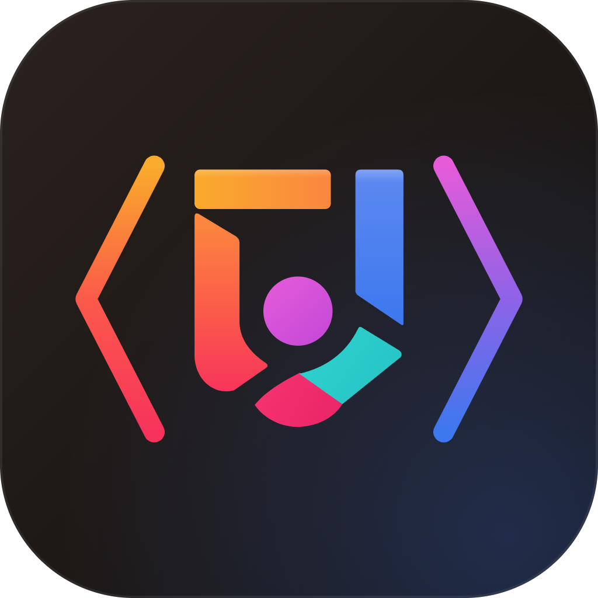

<div align="center">

[EN](docs/CONTRIBUTING.en.md) | **繁中**



</div>

# 貢獻指南

歡迎回報問題、修正錯誤、補充知識文件或改進指令。一般貢獻使用 Fork 與 Pull Request；較大的改動（新指令、改變身分判斷、改變語言包格式）請先開 Issue 說明目的。

## 使用 AI 工具

這個插件本身就是給 AI 用的，當然不排斥 AI。用 AI 工具協助撰寫的貢獻和手寫的一視同仁，不需要標註，也不會因此被拒絕。條件和 [BOT.](https://github.com/keeiv/bot/blob/main/CONTRIBUTING.md#使用-ai-工具) 一樣：你讀過並理解送出的每一行，而且沒有安全隱患。

## 開發環境

需要 Claude Code、Git 與 Node.js（型別檢查用）。在倉庫根目錄：

```bash
claude plugin validate .
claude plugin test .
```

開發時可以用 `claude --plugin-dir <倉庫路徑>` 啟動一個掛上這份原始碼的工作階段，在 BOT. 的專案裡試 `/scan` 和 `/bot-check`。

## 程式的規則

- 主程式是 `hooks/register.ts`，透過 Claude Code 的插件 hook 運作。`$`（引擎介面）只能傳給**檔案最上層宣告的函式**，傳給閉包會被 `claude plugin validate` 拒絕。
- 只用本機的 git 指令與檔案讀取；不連網路，不讀 `.env` 或任何憑證。
- 新的使用者可見文字：在 `types/index.d.ts` 的 `MessageKey` 加上鍵，在 `register.ts` 的 `ENGLISH` 加上英文預設，用 `say(pack, key, values)` 輸出。英文是預設語言，其他語言由語言包提供。
- 給模型看的內容（系統提示、`/scan` 交給 Claude 的摘要）一律用英文。
- 改了偵測或身分判斷，就在 `tests/classify.test.ts` 補上對應情況。
- 註解用英文，說明為什麼這樣做。

## 知識文件

`knowledge/` 的六份文件整理自 BOT. 倉庫的 `CONTRIBUTING.md`、`docs/DEVELOPMENT.md` 與 CI 設定。

- 每一項說法都要能在 BOT. 的程式或文件裡找到根據；寫之前先查證，不憑印象。
- BOT. 改了規則，這裡要跟著改；兩邊不一致時以 BOT. 為準。
- 新增文件時，記得在 `register.ts` 的 `projectSection` 與 README 的表格加上它。

## 提交

提交訊息沿用 BOT. 的格式：第一行 `類型: 繁體中文主旨`，類型用 `feat`、`fix`、`docs`、`refactor`、`test`、`chore`。PR 說明寫清楚問題、變更後的行為與驗證結果。

不要提交 `.claude-plugin/types/`（引擎產生的型別檔）、Token、金鑰或任何個人資料。

## 發布

維護者修改 `.claude-plugin/plugin.json` 的 `version`，推送後用 `gh release create` 建立對應的版本。已安裝的人更新 marketplace 後就會拿到新版。

## 授權

AGPL-3.0-only，作者 Keeiv。新貢獻採用相同授權。
