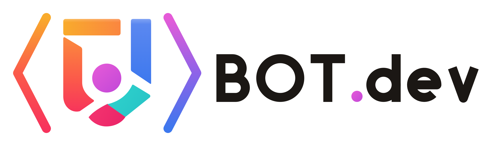

<div align="center">

[EN](docs/README.en.md) | **繁中**

<h1>
  <picture>
    <source media="(prefers-color-scheme: dark)" srcset="assets/bot-dev-wordmark-light.png">
    
  </picture>
</h1>

</div>

為 [BOT.](https://github.com/keeiv/bot)（Keeiv 的 discord.py 機器人）撰寫的 Claude Code 插件。在 BOT. 的專案裡，它會告訴 Claude 專案怎麼組成、什麼才算完成、變更怎麼提交；在其他地方完全不作用。

## 安裝

在 Claude Code 終端機的輸入框輸入：

```
/plugin install bot-dev --marketplace keeiv/bot-dev
```

詢問是否新增 marketplace 時回答 `y`，再選擇安裝範圍（一般選 user）。也可以在 shell 執行：

```
claude plugin install bot-dev --marketplace keeiv/bot-dev
```

桌面版不能使用 `/plugin`：點輸入框旁的 +，選 Plugins，用 `keeiv/bot-dev` 新增 marketplace，再新增插件。

## 它做什麼

- **偵測專案。** 在 git 根目錄尋找 `src/bot.py`、`src/cogs`、`src/locales/help.py`、`src/utils/command_sync.py`，以及專案名稱為 `discord-bot` 的 `pyproject.toml`。全部符合才會作用，其他資料夾不加任何東西。
- **判斷你的身分。**
  - `owner`（擁有者）：`origin` 是 keeiv/bot，而且 `git config user.name` 是 `keeiv`。完整檢查通過後直接提交到 `main`。
  - `contributor`（貢獻者）：keeiv/bot 的 clone 或 fork（有 remote 指向它，或歷史與它有相同的根提交）。變更走 Fork 與 Pull Request。
  - `derivative`（衍生副本）：看起來像 BOT.，但和 keeiv/bot 沒有關聯。工程規則照樣適用，推送前 Claude 會先問清楚怎麼提交。
  - 可以用 `git config bot-dev.role owner` 或 `git config bot-dev.role contributor` 指定身分。
- **透過系統提示告訴 Claude 專案規則**：Cog 與 Service 的分工、`run_storage`、文件儲存、中英文介面、註解風格、`sync_global`、與 CI 相同的檢查、提交格式，以及你的身分對應的提交流程。

## 指令

| 指令 | 用途 |
| --- | --- |
| `/scan` | 重新偵測專案，回報版本、身分、分支、最新提交與未提交的檔案，並把所有 Cog、Service、語系檔與測試檔交給 Claude。 |
| `/bot-check` | 執行和 CI 相同的檢查（pytest、flake8、black、isort、bandit），有 `.venv` 就用專案的 Python；回報每一項結果，並把失敗項目的最後輸出交給 Claude。MySQL 整合測試只在 CI 執行。 |

## 知識文件

Claude 動手做較大的工作前會先讀這些文件。內容整理自倉庫的 `CONTRIBUTING.md`、`docs/DEVELOPMENT.md` 與 CI 設定；兩者不一致時以倉庫為準。

| 檔案 | 內容 |
| --- | --- |
| `knowledge/architecture.md` | 啟動流程、分層、儲存、中英文介面、程式風格、區網節點 |
| `knowledge/done.md` | 什麼才算完成、CI 檢查、安全檢查清單 |
| `knowledge/shipping.md` | 提交訊息、不能提交的東西、擁有者與貢獻者的流程 |
| `knowledge/recipes.md` | 照步驟做：新指令、新功能模組、新儲存欄位、新資料表 |
| `knowledge/testing.md` | 測試環境的隔離方式，以及哪些測試在守護專案慣例 |
| `knowledge/map.md` | 每個功能的 Cog 與 Service 在哪裡 |

## 語言包

bot-dev 預設說英文。其他插件可以攔截它的 `language` 狀態寫入，讓它改說別的語言；狀態的格式定義在 `types/index.d.ts` 的 `LanguagePack`：

```ts
on('state.set', { plugin: 'bot-dev', key: 'language' }, ($, e, next) =>
  next({
    ...e,
    value: {
      tag: 'fr',
      knowledge: `${$.plugin.root}/knowledge`, // 上面六份文件的譯本
      replyLanguage: 'French',
      messages: { 'scan.location': 'Emplacement : {root}' }, // 任何 MessageKey；沒給的維持英文
    },
  }),
).catch(($, e, next) => (next.called ? undefined : next(e)))
```

在語言包的 `plugin.json` 把 `bot-dev` 列進 `dependencies`，就能取得型別。

## 需求

`PATH` 裡要有 Git；`/bot-check` 需要 Python。偵測只執行本機的 git 指令，不會傳送任何資料。

## 開發

見[貢獻指南](CONTRIBUTING.md)。

## 授權

AGPL-3.0-only，與 BOT. 相同。
