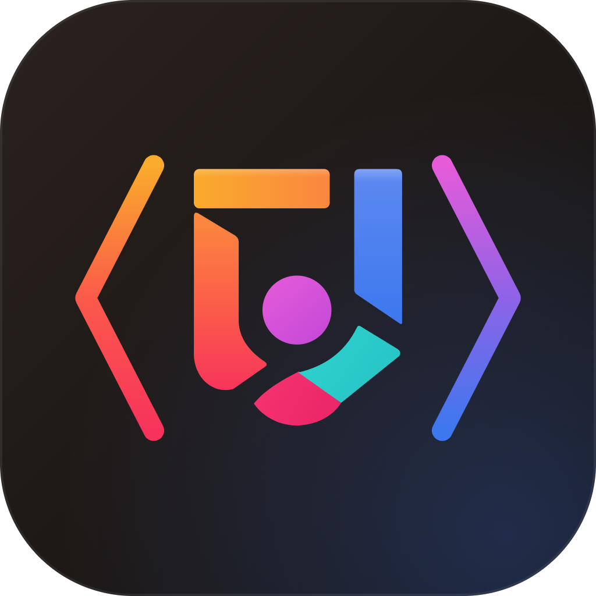

<div align="center">

**EN** | [繁中](../CONTRIBUTING.md)



</div>

# Contributing

Bug reports, fixes, knowledge updates and better commands are all welcome. Contributions go through a fork and a pull request; for larger changes (a new command, a change to role detection or to the language pack format) open an issue first and say what it is for.

## Using AI tools

This plugin exists for an AI to use, so AI tools are welcome here. A contribution written with their help is treated the same as one written by hand; it needs no label and is not turned down for it. The conditions are the same as [BOT.'s](https://github.com/keeiv/bot/blob/main/docs/CONTRIBUTING.en.md#using-ai-tools): you have read and understood every line you send, and it carries no security problem.

## Development environment

You need Claude Code, Git, and Node.js for type checking. From the repository root:

```bash
claude plugin validate .
claude plugin test .
```

While developing, `claude --plugin-dir <path to this repository>` starts a session with this source loaded; try `/scan` and `/bot-check` inside a BOT. checkout.

## Code rules

- The plugin is `hooks/register.ts`, built on Claude Code's plugin hooks. `$` (the engine interface) may only be passed to **functions declared at the top level of the file**; passing it to a closure is refused by `claude plugin validate`.
- Use local git commands and file reads only: no network, no `.env`, no credentials.
- New text a person sees: add its key to `MessageKey` in `types/index.d.ts` and its English default to `ENGLISH` in `register.ts`, and print it with `say(pack, key, values)`. English is the default; other languages come from language packs.
- What the model reads (the system prompt, the summary `/scan` hands Claude) stays in English.
- A change to detection or role logic comes with its cases in `tests/classify.test.ts`.
- Comments are in English and say why.

## Knowledge files

The six files in `knowledge/` summarise BOT.'s `CONTRIBUTING.md`, `docs/DEVELOPMENT.md` and CI workflow.

- Every claim must be backed by BOT.'s code or documents; check before writing, not from memory.
- When BOT. changes a rule, change it here too; where the two disagree, BOT. wins.
- A new file is also listed in `projectSection` in `register.ts` and in the README tables.

## Commits

Commit messages follow BOT.'s format: first line `type: summary in Traditional Chinese`, with type `feat`, `fix`, `docs`, `refactor`, `test` or `chore`. A pull request states the problem, the behaviour after the change and how it was verified.

Do not commit `.claude-plugin/types/` (types the engine generates), tokens, keys or any personal data.

## Releases

The maintainer bumps `version` in `.claude-plugin/plugin.json`, pushes, and creates the matching release with `gh release create`. People who installed the plugin get it after updating the marketplace.

## License

AGPL-3.0-only, author Keeiv. New contributions use the same license.
