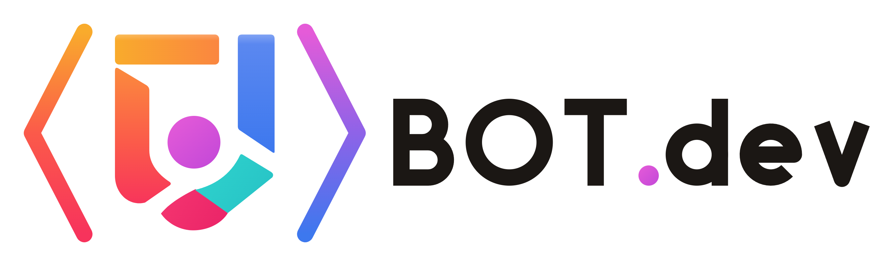

<div align="center">

**EN** | [繁中](../README.md)

<h1>
  <picture>
    <source media="(prefers-color-scheme: dark)" srcset="../assets/bot-dev-wordmark-light.png">
    
  </picture>
</h1>

</div>

A Claude Code plugin for working on [BOT.](https://github.com/keeiv/bot), the discord.py bot by Keeiv. Inside a BOT. checkout it tells Claude how the project is built, what "done" means there and how changes are shipped. Anywhere else it stays silent.

## Install

At the prompt of a Claude Code terminal session:

```
/plugin install bot-dev --marketplace keeiv/bot-dev
```

Answer `y` to add the marketplace, then pick a scope (user is the usual choice). From a shell instead:

```
claude plugin install bot-dev --marketplace keeiv/bot-dev
```

In the desktop app, where `/plugin` does not run: click + next to the prompt box, then Plugins, Add marketplace with `keeiv/bot-dev`, then Add plugin.

## What it does

- **Detects the project.** At the git root it looks for `src/bot.py`, `src/cogs`, `src/locales/help.py`, `src/utils/command_sync.py` and a `pyproject.toml` naming `discord-bot`. Only when all are present does the plugin act; in any other folder it adds nothing.
- **Works out your role.**
  - `owner`: `origin` is keeiv/bot and `git config user.name` is `keeiv`. Changes go straight to `main` after the full checks.
  - `contributor`: a clone or fork of keeiv/bot (a remote points at it, or the history shares its root commit). Changes go through a fork and a pull request.
  - `derivative`: looks like BOT. but nothing ties it to keeiv/bot. The engineering rules apply, and Claude asks how changes are shipped before pushing.
  - Pin a role with `git config bot-dev.role owner` or `git config bot-dev.role contributor`.
- **Briefs Claude** through its system prompt while you are in the project: the cog and service split, `run_storage`, document storage, bilingual text, comment style, `sync_global`, the exact CI checks, the commit format and the shipping rules for your role.

## Commands

| Command | What it does |
| --- | --- |
| `/scan` | Re-detects the checkout and reports the version, role, branch, latest commit and uncommitted files, then hands Claude every cog, service, locale module and test file. |
| `/bot-check` | Runs the checks CI runs (pytest, flake8, black, isort, bandit) with the project's `.venv` when it has one, reports each result and gives Claude the end of any failing output. MySQL integration tests stay CI-only. |

## Knowledge files

Claude reads these before larger work. They summarise the repository's `CONTRIBUTING.md`, `docs/DEVELOPMENT.md` and CI workflow; where they disagree, the repository wins.

| File | Covers |
| --- | --- |
| `knowledge/architecture.md` | Startup, layers, storage, bilingual interface, code style, LAN nodes |
| `knowledge/done.md` | When a change counts as done, the CI checks, the security checklist |
| `knowledge/shipping.md` | Commit messages, what never to commit, owner and contributor workflows |
| `knowledge/recipes.md` | Step-by-step: a new command, a new feature module, a stored field, a table |
| `knowledge/testing.md` | What the test harness isolates and which tests guard the conventions |
| `knowledge/map.md` | Where each feature's cog and service live |

## Language packs

bot-dev speaks English. Another plugin can make it speak another language by hooking the write of its `language` state, declared in `types/index.d.ts` as a `LanguagePack`:

```ts
on('state.set', { plugin: 'bot-dev', key: 'language' }, ($, e, next) =>
  next({
    ...e,
    value: {
      tag: 'fr',
      knowledge: `${$.plugin.root}/knowledge`, // the six files above, translated
      replyLanguage: 'French',
      messages: { 'scan.location': 'Emplacement : {root}' }, // any MessageKey; the rest stay English
    },
  }),
).catch(($, e, next) => (next.called ? undefined : next(e)))
```

List `bot-dev` under `dependencies` in the pack's `plugin.json` to get the types.

## Requirements

Git on the `PATH`, and Python for `/bot-check`. Detection runs local git commands only; nothing is sent anywhere.

## Development

See [Contributing](CONTRIBUTING.en.md).

## License

AGPL-3.0-only, the same as BOT.
